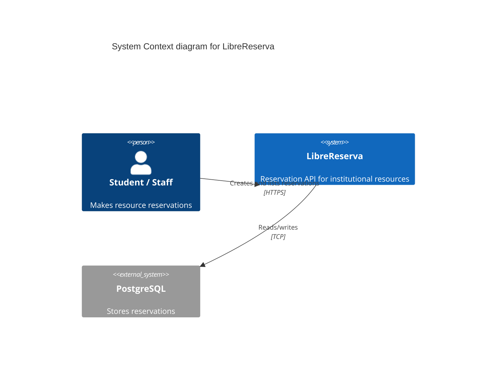
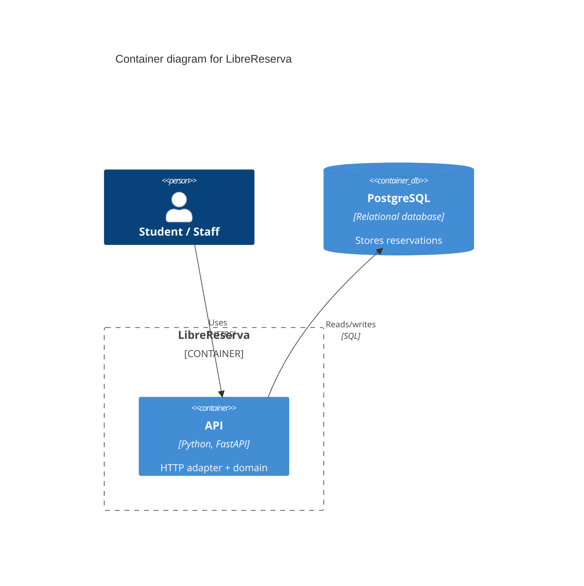

# C4 Model – LibreReserva (Context & Containers)

## System Context

## Containers

## Notes

- The domain core lives inside the API container and has no direct dependency on PostgreSQL.
- Persistence is an adapter injected at startup.
